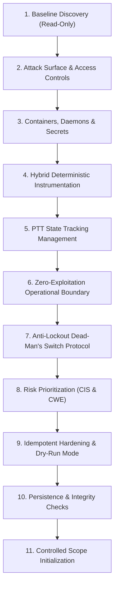

<div align="center">

# VPS CyberSec Orchestrator (v1.0.1)
### Autonomous Linux VPS Security Auditor, Attack Surface Analyzer & Idempotent Hardening Orchestrator

[](LICENSE)
[](https://github.com/abrantess/vps-cybersec-orchestrator)
[](https://www.cisecurity.org/)
[](bin/anti_lockout_guard.sh)
[](schemas/ptt_manifest.schema.json)

<p align="center">
  A production-ready, non-destructive DevSecOps orchestration toolkit designed to conduct automated security assessments, attack surface reduction, and idempotent hardening on Linux VPS environments (Ubuntu, Debian, RHEL, Rocky, Alpine) for Systems Engineers, SREs, and Autonomous AI Agents.
</p>

</div>

---

## 🌟 Core Epistemic Philosophy: Hybrid Determinism

Modern infrastructure security demands bridging **Mechanical Determinism (Old School)** with **Cognitive Agentic Orchestration (New School)**:

```
┌────────────────────────────────────────────────────────────────────────────────────────┐
│                        VPS CYBERSEC ORCHESTRATOR ARCHITECTURE                          │
├────────────────────────────────────────────────────────────────────────────────────────┤
│                                                                                        │
│   [OLD SCHOOL: DETERMINISTIC BARE-METAL CONTROLS]                                      │
│   ┌────────────────────────────────────────────────────────────────────────────────┐   │
│   │  POSIX / Bash Collector • CIS Sysctl Hardening • UFW / Netfilter Micro-Rules   │   │
│   │  OpenSSH Dynamic Port Detection • First-Match 00- Drop-in Priority             │   │
│   │  Dead-Man's Switch Rollback Guard • Secure /root/.vps_anti_lockout_backup (0700)│   │
│   └───────────────────────────────────────┬────────────────────────────────────────┘   │
│                                           │                                            │
│                                           ▼                                            │
│   [NEW SCHOOL: STRUCTURED AGENTIC ORCHESTRATION]                                       │
│   ┌────────────────────────────────────────────────────────────────────────────────┐   │
│   │  Phase Tracking Tree (PTT) • Zero-Exploitation Contract • Model Context Protocol│   │
│   │  Machine-Readable JSON Telemetry • Structured CWE / CIS Mappings • Dry-Run Sim │   │
│   └────────────────────────────────────────────────────────────────────────────────┘   │
│                                                                                        │
└────────────────────────────────────────────────────────────────────────────────────────┘
```

1. **Mechanical Determinism (Old School):** Idempotent state convergence, kernel memory mitigations (`sysctl`), strict firewall policies (`UFW`/`iptables`), dynamic active SSH port detection, first-match drop-in precedence (`00-vps-hardening.conf`), and cryptographic verification.
2. **Cognitive Orchestration (New School):** Structured state tracking via **Phase Tracking Tree (PTT)** schemas, preventing context loss in autonomous agent workflows, enforcing zero-hallucination evidence validation, and outputting clean JSON/Markdown artifacts.

---

## 📋 The 11-Step DevSecOps Execution Protocol

The engine strictly implements the formalized 11-step defensive protocol:



| Step | Focus Area | Technical Operation & Objective |
|:---:|---|---|
| **1** | **Baseline Discovery** | Non-destructive extraction of kernel release, architecture, uptime, active systemd services, and sysctl baseline. |
| **2** | **Attack Surface & Access** | Audit of OpenSSH daemon config, PAM policies, listening sockets (`ss -tulnp`), and firewall rules. |
| **3** | **Containers & Secrets** | Detection of Docker/Podman daemon configurations, rootless mode, socket permissions (`/var/run/docker.sock`), and container port exposure. |
| **4** | **Hybrid Instrumentation** | Structured evidence collection and triage (Confirmed vs. Heuristic) with automated JSON/Markdown generation. |
| **5** | **PTT State Tracking** | Maintaining cognitive session state across 5 formal phases via JSON-Schema (`schemas/ptt_manifest.schema.json`). |
| **6** | **Zero-Exploitation** | Strict adherence to read-only non-destructive auditing: no brute-force, no DoS, and zero credential printing. |
| **7** | **Anti-Lockout Protocol** | Arming an automatic dead-man's switch rollback timer (stored in mode 0700) before touching any network, firewall, or SSH settings. |
| **8** | **Formal Risk Prioritization** | Mapping findings against CWE (Common Weakness Enumeration) and CIS Linux Benchmark levels. |
| **9** | **Idempotent Hardening** | Re-runnable, state-convergent shell scripts with `--dry-run` simulation flags and dynamic SSH port detection. |
| **10** | **Persistence Detection** | Inspection of `/etc/ld.so.preload`, crontabs, systemd timers, and SUID/SGID binaries. |
| **11** | **Controlled Initialization** | Initial scope bounding and interactive questionnaire to prevent accidental collateral disruption. |

---

## ⚡ Quickstart Guide

### 1. Non-Destructive Read-Only Security Audit
Run the automated collector to analyze the host and generate structured JSON & Markdown reports:

```bash
# Clone the repository
git clone https://github.com/abrantess/vps-cybersec-orchestrator.git
cd vps-cybersec-orchestrator

# Run read-only audit collector
sudo bash bin/vps_audit.sh ./reports
```

*Output:*
- `./reports/vps_audit_<HOSTNAME>_<TIMESTAMP>.json`: Machine-readable telemetry conforming 100% to `schemas/ptt_manifest.schema.json`.
- `./reports/vps_audit_<HOSTNAME>_<TIMESTAMP>.md`: Formatted executive Markdown summary.

---

### 2. Dry-Run Hardening Simulation
Preview all proposed hardening changes (sysctl, sshd, firewall) without applying any mutations to the server:

```bash
sudo bash bin/vps_harden.sh --dry-run
```

---

### 3. Active Idempotent Hardening with Dead-Man's Switch
Apply CIS-compliant system hardening with an automatic 5-minute safety rollback timer:

```bash
sudo bash bin/vps_harden.sh --confirm
```

> 🛡️ **Zero-Lockout Verification Workflow:**
> 1. The hardening engine automatically arms `bin/anti_lockout_guard.sh` for **5 minutes** before mutating firewall or SSH configurations.
> 2. **DO NOT CLOSE YOUR ACTIVE TERMINAL.** Open a **new terminal window** and verify connectivity:
>    ```bash
>    ssh -p <SSH_PORT> user@<vps_ip>
>    ```
> 3. Once connectivity is confirmed in the new session, explicitly disarm the safety switch:
>    ```bash
>    sudo bash bin/anti_lockout_guard.sh disarm
>    ```
> 4. If connectivity is lost or unverified, the server **automatically rolls back** firewall rules, deletes conflicting drop-ins, and restores original SSH configs after 5 minutes.

---

## 🔒 Automated Hardening Matrix

| Component | Default Unhardened State | Hardened State Enforced (v1.0.1) | CIS Linux Benchmark |
|---|---|---|---|
| **SSH Daemon** | Password auth enabled, root password login allowed | `PasswordAuthentication no`, `PermitRootLogin prohibit-password`, `MaxAuthTries 3` (in `00-vps-hardening.conf`) | CIS 5.2.10, 5.2.11 |
| **Dynamic SSH Port** | Hardcoded port 22 assumptions | Dynamically queries `sshd -T` and binds UFW rules to the active SSH port | CIS 3.5.1 |
| **Kernel Sysctl** | ICMP redirects accepted, martians unlogged | `accept_redirects = 0`, `log_martians = 1`, `rp_filter = 1`, `tcp_syncookies = 1` | CIS 3.2.1 - 3.2.8 |
| **Memory ASLR** | Variable randomization level | `kernel.randomize_va_space = 2` (Full ASLR) | CIS 1.6.2 |
| **Host Firewall** | Default allow / unconfigured | `UFW` default deny incoming, rate-limited active SSH port, allowed web ports | CIS 3.5.1 |
| **Docker Daemon** | Live restore disabled / socket exposed | Safe merge of `{"live-restore": true}` in `/etc/docker/daemon.json` | CIS Docker 2.1 |

---

## 🤖 AI Agent & MCP Integration

This repository is natively architected for consumption by autonomous AI agents (Anthropic Claude Code, OpenAI Codex, Google Gemini CLI, OpenCode):

- **PTT State Schema:** `schemas/ptt_manifest.schema.json` defines the contract for 5-phase multi-turn reasoning trees.
- **Sample Agent Output:** `examples/audit_report_sample.json` provides the target JSON structure for programmatic ingestion.

---

## 🗺️ Roadmap & Ecosystem Integrations

- [ ] Automated integration with Lynis & OpenSCAP local benchmark harnesses.
- [ ] Native Nmap external attack surface differential scanners.
- [ ] eBPF runtime network packet inspection for container bridge monitoring.
- [ ] Automated SSH key rotation and cryptographic expiration alerting.

---

## 🤝 Contributing

Contributions from the global DevSecOps, SRE, and AI engineering community are welcome:
1. Fork the Project (`https://github.com/abrantess/vps-cybersec-orchestrator/fork`).
2. Create your Feature Branch (`git checkout -b feature/NewAuditCheck`).
3. Commit your Changes (`git commit -m 'feat: add eBPF socket monitoring check'`).
4. Push to the Branch (`git push origin feature/NewAuditCheck`).
5. Open a Pull Request.

---

## 📜 License

Distributed under the **MIT License**. See [`LICENSE`](LICENSE) for more information.

<div align="center">
<sub>Authored by <b>Abrantes AI Architect</b> (<a href="https://github.com/abrantess">@abrantess</a>) • Independent AI Systems Architect.</sub>
</div>
